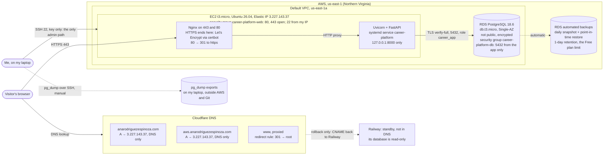

# Personal Resume and Career Platform

A FastAPI application with server-rendered Jinja templates and SQLAlchemy/Alembic, running on **AWS**: an EC2 instance for the app and a Single-AZ RDS PostgreSQL database, at **https://anarodriguezespinoza.com** (since 2026-11-10). It moved there from [Railway](https://railway.com), which is kept as a read-only standby for rollback. The code also supports Cognito sign-in, SES notifications, and an S3 snapshot fallback for public content; those integrations are not configured (see [What is turned off](#what-is-turned-off)).

## How the site runs



Unfinished pieces: the `pg_dump` exports are manual so far, with no nightly job yet. The only copies are on my laptop, not yet on separate storage too. Railway still runs as a standby.

| Piece | Where |
| --- | --- |
| Web app | EC2 instance `career-platform-production` (t3.micro, Ubuntu Server 26.04 LTS, us-east-1a), Elastic IP `3.227.143.37`. The code is in `/opt/career-platform/app`, the virtualenv in `/opt/career-platform/venv`, and the systemd unit is [`deploy/aws/career-platform.service`](deploy/aws/career-platform.service) |
| Front door | Nginx ([`deploy/aws/nginx-career-platform.conf`](deploy/aws/nginx-career-platform.conf)): HTTPS on 443 with one Let's Encrypt certificate for `anarodriguezespinoza.com` and `aws.anarodriguezespinoza.com`, renewed by `certbot.timer`. Port 80 redirects to HTTPS |
| Database | RDS `career-platform-production`: PostgreSQL 18.6, db.t3.micro, Single-AZ, 20 GB gp3, encrypted, not publicly accessible, deletion protection on. The app connects as `career_app` with `sslmode=verify-full` |
| Source | GitHub `main`. Deploys are manual (see [Operating the site](#operating-the-site)), and `/opt/career-platform/REVISION` records the commit that's running |
| Domain | `anarodriguezespinoza.com`, DNS on Cloudflare: a DNS-only `A` record to the Elastic IP, plus `aws` for testing. `www` is a proxied record that a Cloudflare redirect rule sends to the root with a `301`. `_railway-verify` stays during the rollback period |
| Email | Zoho Mail for `ana@anarodriguezespinoza.com` (MX, SPF, DKIM, DMARC on Cloudflare) |
| Analytics | Google Analytics 4 (`G-JH0KBKW3K9`), loaded only after the visitor accepts the consent banner |

The app reads `/etc/career-platform/app.env` (root only, mode 600) through systemd's `EnvironmentFile=`: `DATABASE_URL`, `APP_ENV=production` (makes the session cookie `Secure`), and `SITE_URL=https://anarodriguezespinoza.com`. Uvicorn listens on loopback only and trusts forwarded headers only from Nginx. Never commit or print the database URL or passwords. They live in that file and in `~/career-platform-cutover/aws/` on my laptop.

### What is turned off

`COGNITO_*`, `S3_SNAPSHOT_*`, and `SES_*` are unset, as they were on Railway, so:

- **Admin sign-in (`/admin`) doesn't work.** Edit content directly in the database (see [Operating the site](#operating-the-site)) and set `publicationState` to `PUBLISHED` for it to appear publicly.
- **Contact submissions are saved** to `ContactInquiry` with `notificationStatus = FAILED`, because no email is sent.
- **There is no snapshot fallback.** If the database is down, `/`, `/about`, and `/projects` still show the profile from `app/content/profile.json`, the projects section says "Projects temporarily unavailable", and the status is 503. The other public pages return the 503 "temporarily unavailable" page, and `/api/health` returns `{"status":"unavailable",...}` with HTTP 503. Live reads resume on the next request once the database is back; no restart is needed.

A healthy deploy returns `{"status":"ok","database":"up","publicSource":"database"}`.

## Operating the site

Sign in to the AWS CLI as the IAM user `isba-student` (never root). The session lasts up to 12 hours:

```bash
aws login --profile isba-4775 --region us-east-1
aws sts get-caller-identity --profile isba-4775     # must end in user/isba-student
```

SSH allows only my current IP. If it times out, my IP has probably changed: replace the port-22 rule in the `career-platform-web` security group with the new `/32`. Common tasks:

```bash
ssh -i ~/.ssh/id_ed25519 ubuntu@3.227.143.37
systemctl status career-platform nginx
sudo journalctl -u career-platform -n 100 --no-pager      # app logs
sudo tail -n 50 /var/log/nginx/access.log /var/log/nginx/error.log
sudo certbot renew --dry-run                               # certificate renewal check
curl -sS https://anarodriguezespinoza.com/api/health
```

**Deploy a new commit** (from the repository root on my laptop). Ship the code, install it, run migrations once as the release step, then restart:

```bash
git archive --format=tar HEAD | ssh ubuntu@3.227.143.37 'sudo rm -rf /opt/career-platform/app.new && sudo mkdir /opt/career-platform/app.new && sudo tar -x -C /opt/career-platform/app.new && sudo rm -rf /opt/career-platform/app && sudo mv /opt/career-platform/app.new /opt/career-platform/app'
git rev-parse HEAD | ssh ubuntu@3.227.143.37 'sudo tee /opt/career-platform/REVISION >/dev/null'
ssh ubuntu@3.227.143.37 'sudo /opt/career-platform/venv/bin/pip install -q /opt/career-platform/app \
  && sudo systemd-run --quiet --wait --pipe --uid=career-platform -p EnvironmentFile=/etc/career-platform/app.env -p WorkingDirectory=/opt/career-platform/app /opt/career-platform/venv/bin/alembic upgrade head \
  && sudo systemctl restart career-platform'
curl -sS https://anarodriguezespinoza.com/api/health
```

Migrations run through `systemd-run` so they read the same env file as the service. Loading it with a shell `source` breaks on the `&` in `DATABASE_URL`. Never run `python -m app.seed` against production.

RDS isn't reachable from my laptop, so database work runs on the instance with `psql`, `pg_dump`, and `pg_restore` 18 from `postgresql-client-18`. To compare two databases row by row (counts only), use `python -m app.compare_databases SOURCE_URL TARGET_URL`. To move rows from an older SQLite database into an empty, already-migrated database:

```bash
python -m app.copy_database SOURCE_URL TARGET_URL   # prints row counts only; refuses a non-empty target
```

## Local development

1. Copy `.env.example` to `.env` and provide local development values. The default `DATABASE_URL` is a local SQLite file.
2. Create a virtual environment and install dependencies:

   ```bash
   python3 -m venv .venv && source .venv/bin/activate
   pip install -e ".[dev]"
   ```

3. Create and seed the local database, then start the server:

   ```bash
   set -a && source .env && set +a
   alembic upgrade head
   python -m app.seed
   uvicorn app.main:app --reload
   ```

   The site runs at http://localhost:8000.

Available checks:

- `ruff check app tests e2e migrations`
- `pytest`. Set `TEST_POSTGRES_URL` to a **throwaway** PostgreSQL database to also run the Postgres migration and copy tests. They drop every table in that database. CI runs them against a `postgres:16` service.
- `pytest e2e` is the release gate. It needs `pip install -e ".[e2e]"`, `playwright install chromium`, and the `E2E_*` variables.

Styles are Tailwind classes in `app/templates/`, compiled to the committed `app/static/css/site.css`. Run `./scripts/build-css.sh` (uses `npx tailwindcss@3`) after changing classes.

## Project layout

- `app/main.py`: application factory and error handlers
- `app/routes/`: public pages, `/api` endpoints, sign-in, and owner-only `/admin` routes
- `app/templates/`: Jinja templates
- `app/domain/`: publication rules, snapshot fallback, admin content service, inquiries, resume PDF
- `app/models.py`, `app/repositories.py`, `migrations/`: database models, data access, Alembic migrations
- `app/copy_database.py`: one-shot SQLite → PostgreSQL row copy
- `deploy/aws/`: the systemd unit and Nginx site running on the EC2 instance
- `Dockerfile`, `railway.json`: container image and Railway deploy configuration (Railway is now the standby)
- `tests/`: pytest suite; `e2e/`: Playwright release-gate tests
- `infra/`: AWS CDK (TypeScript), not used by the live AWS deployment, which was built with the AWS CLI

## Architecture and operations

- [Project 1 submission index](docs/project-1-submission.md): the live URL, final commit, and where the evidence for each requirement lives.
- [Design spec](docs/superpowers/specs/2026-09-15-personal-resume-career-platform-design.md) and plans: [app build](docs/superpowers/plans/2026-09-17-personal-resume-career-platform.md), [Azure VM migration](docs/superpowers/plans/2026-09-24-azure-vm-migration.md), [operate the VM](docs/superpowers/plans/2026-10-01-operate-the-vm.md), [Railway + PostgreSQL migration](docs/superpowers/plans/2026-10-08-railway-postgres-migration.md), [AWS EC2 + RDS migration](docs/superpowers/plans/2026-11-03-aws-ec2-rds-migration.md) (with its step-by-step log and deviations in [migration-notes.md](migration-notes.md)).
- Evidence: [ex07 (AWS migration)](docs/evidence/ex07.md), [ex03 (Azure VM)](docs/evidence/ex03.md), [ex05 (DNS investigation)](docs/evidence/ex05.md), [ex06 (email and analytics)](docs/evidence/ex06.md), [Zoho header check](docs/evidence/zoho-header-check.md), [final DNS records](docs/evidence/dns-records-final.md), [HTTPS checks](docs/evidence/https-checks.md), [encryption on the VM](docs/evidence/encryption.md), [how this site is secured](docs/how-this-site-is-secured.md).
- Diagrams: [request paths for Azure and Railway, with email and analytics](docs/diagrams/request-path.md) ([Railway PNG](docs/diagrams/request-path-railway.png), [Azure PNG](docs/diagrams/request-path-azure.png)), [system architecture](docs/diagrams/system-architecture.mmd), [data model](docs/diagrams/data-model.mmd).
- [System architecture](docs/architecture.md): request paths, fallback behavior, health contract, and security boundaries.
- [Database and privacy model](docs/database.md): models, publication states, public projection, inquiries, and migrations.
- [Deployment and recovery](docs/deployment.md): the Railway configuration, release migrations, health verification, and the AWS recovery commands.
- [Glossary](docs/glossary.md): shared platform terminology.

## Decisions

| Decision | Chosen | Alternatives considered | Why |
| --- | --- | --- | --- |
| First database engine | **SQLite**, one file (`data.db`) on the Azure VM's disk | PostgreSQL on the same VM; Azure Database for PostgreSQL | One VM, one process, mostly reads: SQLite needed no extra server to install, secure, patch, or pay for, and the app reads it with no network hop. The costs I accepted: one writer at a time, data tied to that VM's disk, backups by copying the file. Those costs are what the Railway move later addressed |
| Move hosting to Railway | **Railway** web service + Railway PostgreSQL | Keep the VM and add Postgres to it; Azure App Service + Azure Database for PostgreSQL; Render or Fly.io | On the VM I owned the OS, patches, Nginx, certbot, systemd, the firewall, and backups. Railway builds the Dockerfile on every push to `main`, runs migrations before traffic moves, health-checks, restarts, and terminates TLS, so I only own the code, config, and data. Managed Postgres removes the single-file, single-writer limits. Azure's managed equivalents would cost more of the student credit for the same result |
| Move hosting to AWS | **EC2 + Single-AZ RDS PostgreSQL** | EC2 with PostgreSQL on the same instance; Lambda + API Gateway + RDS | I chose EC2 with RDS over EC2 with local PostgreSQL because I wanted to learn AWS without running the database myself: RDS handles PostgreSQL patching and automated backups. I accepted paying for a second service (about $28/month estimated, most of it RDS) and securing the network path between the two. Lambda would have meant app changes (an ASGI adapter), connection handling for RDS, cold starts, and a NAT gateway or endpoints for outside calls, for a site this small |
| Email | **Managed: Zoho Mail** (free plan) | Self-hosted Postfix/Dovecot on the VM; Google Workspace; Cloudflare Email Routing | Self-hosting means running SMTP, spam filtering, DKIM signing, TLS, and storage myself, and Azure blocks outbound port 25 on most subscriptions, including student ones. A new VM IP also has no sending reputation, so mail would likely land in spam. Google Workspace does the same job but is paid. Cloudflare Email Routing only forwards, it can't send as the domain. Zoho gives a real mailbox that sends and receives as `ana@anarodriguezespinoza.com` for free, and SPF, DKIM, and DMARC pass |
| Profile while the database is down | A version-controlled `app/content/profile.json` | Hard-coded template text; a full snapshot store (the S3 code exists but isn't configured on Railway) | The profile stays visible during an outage without inventing text. The file holds only facts that are already public on the resume page (name, headline, summary, education, links), so it never exposes drafts or inquiries |

## Migration: Railway to AWS

**What moved (cutover 2026-11-10, about 06:59 UTC):**
- **App:** from a Railway service built from the `Dockerfile` to Uvicorn under systemd behind Nginx on an EC2 instance.
- **Database:** from Railway PostgreSQL 18 to RDS PostgreSQL 18.6.

The plan is in [docs/superpowers/plans/2026-11-03-aws-ec2-rds-migration.md](docs/superpowers/plans/2026-11-03-aws-ec2-rds-migration.md). Every step and every deviation from the course guide or the plan is logged in [migration-notes.md](migration-notes.md). The test results are in [ex07](docs/evidence/ex07.md).

**How current data was preserved:**

1. **Drill (2026-10-29):** a `pg_dump -Fc` of Railway, restored into a throwaway local PostgreSQL 18. `compare_databases` matched every row (23 of 23), and the app ran on the copy.
2. **Rehearsal (2026-11-09):** a fresh dump, restored on the instance into the empty RDS database **before** any migration, as `career_app`. It took 2 s and matched 26 of 26 rows against live Railway. Then `alembic upgrade head` ran, with nothing to apply.
3. **Freeze (2026-11-10 06:52:44 UTC):** Railway's database was set to read-only (`ALTER DATABASE railway SET default_transaction_read_only = on`), and its open connections were closed. Pages kept loading; only contact submissions would have failed. I didn't point Railway's `DATABASE_URL` at a dead address as first planned: Railway's pre-deploy migration would fail, and the old deploy would keep accepting writes.
4. **Final copy:** a final dump, the RDS database dropped and recreated (which removed the rehearsal data and my test inquiry), the dump restored, and **26 of 26 rows matched** against the frozen source.
5. **DNS:** the root record changed from `CNAME → jf53ce39.up.railway.app` to `A → 3.227.143.37`. It resolved on 1.1.1.1 and 8.8.8.8 within a minute, then certbot added the root domain to the certificate. Writes were frozen for about 7 minutes in total.

**Who is responsible for what now:**

| Layer | Railway | AWS EC2 + RDS |
| --- | --- | --- |
| Operating system | Railway (container host) | **Me**: Ubuntu updates (unattended-upgrades is on), reboots, disk |
| Runtime and process | **Me** in the `Dockerfile`; Railway runs and restarts it | **Me**: Python 3.14 virtualenv, systemd unit with `Restart=on-failure` |
| Network entry and firewall | Railway's edge | **Me**: security groups (80/443 open, 22 from my IP; 5432 only from the app's group) and Nginx |
| TLS | Railway | **Me**: certbot, Let's Encrypt certificate, renewal timer |
| Code | **Me**: push to `main`, Railway deploys | **Me**: manual deploy (see [Operating the site](#operating-the-site)) |
| Configuration and secrets | **Me**: Railway variables | **Me**: `/etc/career-platform/app.env` (root, 600) |
| Database software | Railway | **AWS**: PostgreSQL patching, storage, automated backups. **Me**: the instance class, security group, and retention |
| Data | **Me** | **Me**: rows, migrations, exports outside AWS |
| DNS | **Me**: `CNAME @ → Railway` | **Me**: `A @ → Elastic IP` |

## Backups and recovery

| What | How often | Kept for | Where |
| --- | --- | --- | --- |
| RDS automated backups | Daily snapshot (backup window 09:00–09:30 UTC), plus transaction logs for point-in-time restore | **1 day**, the most the AWS Free plan allows (7 was refused with `FreeTierRestrictionError`) | Inside AWS |
| `pg_dump -Fc` exports | Manual so far: 2026-10-29, 2026-11-09, and the final cutover dump on 2026-11-10 | Until I delete them | `~/career-platform-cutover/` on my laptop (mode 600), outside AWS and Git |

- **Acceptable data loss (RPO): 24 hours.** The only data written after setup is contact inquiries. Losing a day of them means asking people to resend.
- **Acceptable recovery time (RTO): 4 hours.** That's enough to restore and redeploy by hand. Each test restore took about 2 s, so the time goes to setup and checking.

**Restore from an export** (from the laptop, through the instance, since RDS isn't public): copy the dump with `scp` (mode 600). Stop `career-platform`. As `postgres_admin`, drop and recreate `career_platform` owned by `career_app`. Then run `pg_restore --no-owner --no-acl --exit-on-error` as `career_app`, `alembic upgrade head` through `systemd-run`, and start the service. Check with `compare_databases` against the source if it still exists, and with `/api/health`. The exact commands are in [migration-notes.md](migration-notes.md). **Restore from RDS** ("Restore to point in time" or from a snapshot) creates a *new* instance. Point `DATABASE_URL` in `app.env` at it and restart.

## Migration: Azure VM to Railway

**What moved (2026-10-08):** the app moved from `uvicorn` under systemd behind Nginx on `vm-career-platform` (SQLite) to a Railway service built from the `Dockerfile` (PostgreSQL 18). The full step log is in the [migration plan](docs/superpowers/plans/2026-10-08-railway-postgres-migration.md).

**How current data was preserved:**

1. The schema was created on Postgres by Railway's pre-deploy `alembic upgrade head`, the same migration the VM used.
2. The VM app was stopped so no new inquiry could land in SQLite, and `data.db` was copied to my laptop.
3. `python -m app.copy_database` copied every model table into the empty Postgres database in one transaction. It converted the Prisma-era formats: one inquiry stored its timestamps as integer milliseconds, five as text, and booleans as 0/1. It refuses a non-empty target, so it can't half-copy twice.
4. The source held 6 contact inquiries and no content rows. `python -m app.compare_databases` compares source and target row by row, by primary key and every column, and prints counts only. That proves the six inquiries arrived unchanged, which a re-seed can't fake because the seed creates no inquiries.
5. The VM's `data.db` is untouched (last modified 2026-10-06) and stays as the rollback copy.

**Who is responsible for what:**

| Layer | Azure VM | Railway |
| --- | --- | --- |
| Operating system | **Me**: Ubuntu updates, reboots, disk | Railway (container host) |
| Runtime | **Me**: Python and `uv` installed on the VM | **Me** in the `Dockerfile` (`python:3.13-slim`); Railway builds and runs it |
| Entry point / process supervision | **Me**: systemd unit, `Restart=on-failure`, `--workers 2`, `enable` for boot | Railway runs the image's `CMD` and applies `restartPolicyType: ON_FAILURE` from `railway.json` |
| Network entry and firewall | **Me**: NSG rules (22 from my IP, 80, 443) and Nginx on 80/443 | Railway's edge; there's no firewall for me to manage |
| TLS | **Me**: certbot, Let's Encrypt certificate on Nginx, renewal timer | Railway issues and renews the certificate for the verified custom domain |
| Code | **Me**: `git pull` on the VM, restart the service | **Me**: push to `main`; Railway builds and deploys automatically |
| Configuration | **Me**: `.env` file on the VM read by `EnvironmentFile=` | **Me**: Railway service variables (`DATABASE_URL` reference, `APP_ENV`, `SITE_URL`) |
| Database software | **Me**: SQLite library, file permissions | Railway runs PostgreSQL 18 (version, process, storage) |
| Data | **Me**: the `data.db` file and any copies | **Me**: rows, migrations, backups/exports. Railway stores them |
| DNS | **Me** in Cloudflare: `A @ → 9.205.26.169` | **Me** in Cloudflare: `CNAME @ → Railway`, `_railway-verify` TXT, `www` redirect |

## Rollback

### Back to Railway, including writes made on AWS

Railway's service and database are untouched apart from the read-only switch, so they can take over again. Inquiries written on AWS after 2026-11-10 06:59 UTC exist only in RDS. Reconcile them before pointing DNS back:

1. Stop new writes on AWS: `sudo systemctl stop career-platform`.
2. Make Railway's database writable again: `ALTER DATABASE railway RESET default_transaction_read_only`.
3. On the instance, run `compare_databases` with Railway as the source and RDS as the target. Rows listed as `extra` were written on AWS. Copy those `ContactInquiry` rows into Railway and compare again until nothing is `extra`.
4. In Cloudflare, change the root record back to `CNAME → jf53ce39.up.railway.app`, DNS only. `_railway-verify` is still there, so Railway's certificate stays valid. Allow for the 300-second TTL.

### Code

- **Fast:** Railway dashboard → service → **Deployments** → open the last good deployment → **Redeploy**. Railway runs the old image again, after its pre-deploy migration (a no-op if the schema is already at head).
- **Lasting:** `git revert <bad-sha>` → run `ruff` and `pytest` locally → push to `main`. This keeps `main` equal to what's live, so the next push doesn't bring the bad change back. Confirm the new deployment ID with `railway deployment list`, then check `/api/health` and the page the change touched.

### Database changes

- **Before any risky data or schema change,** take a dump: `railway run --service Postgres -- sh -c 'pg_dump "$DATABASE_PUBLIC_URL" -Fc -f ~/career-platform-backups/$(date +%F-%H%M).dump'` (outside the repo; the URL is never printed).
- **Undo a schema migration:** `alembic downgrade -1` against the database only if that migration's `downgrade()` is safe for the data in it. Otherwise ship a new forward migration that fixes it.
- **Undo a data change:** restore the affected table(s) from the dump, e.g. `pg_restore --clean --if-exists -t '"Project"' -d "$DATABASE_PUBLIC_URL" <file>.dump`.

### Back to the Azure VM, including writes made after cutover

Since 2026-10-08 new contact inquiries are written only to Railway Postgres. The VM's `data.db` doesn't have them, so pointing DNS back at the VM alone would silently drop them. To roll back without losing them:

1. **Freeze writes on Railway:** in the Railway dashboard, scale the web service to 0 replicas, or remove its deployment, so no new inquiry is accepted.
2. **Export everything from Postgres into a fresh SQLite file** (laptop):
   ```bash
   DATABASE_URL=sqlite:///$HOME/career-platform-cutover/rollback.db alembic upgrade head
   SOURCE="$(railway variables --service Postgres --kv | sed -n 's/^DATABASE_PUBLIC_URL=//p')"
   python -m app.copy_database "$SOURCE" "sqlite:///$HOME/career-platform-cutover/rollback.db"
   python -m app.compare_databases "$SOURCE" "sqlite:///$HOME/career-platform-cutover/rollback.db"   # expect 0 changed, 0 missing
   unset SOURCE
   ```
   Postgres holds the original 6 inquiries plus everything written after cutover, so the new file is a superset of the VM's.
3. **Swap it in on the VM:** `scp` it to the VM, then `sudo systemctl stop career-platform`, `mv data.db data.db.pre-rollback`, `mv rollback.db data.db`, `sudo systemctl start career-platform`, and check `/projects` and `/api/health` with `curl --resolve anarodriguezespinoza.com:443:9.205.26.169 https://anarodriguezespinoza.com/...`.
4. **Point DNS back:** in Cloudflare replace `CNAME @ → jf53ce39.up.railway.app` with `A @ → 9.205.26.169`, DNS only. The VM's Let's Encrypt certificate covers `anarodriguezespinoza.com` and `www` until 2027-01-04, and certbot can renew it again once the domain resolves to the VM. `www` keeps redirecting to the root. Allow for the 300-second TTL.
5. Set `SITE_URL=https://anarodriguezespinoza.com` in the VM's `.env` and restart the service.

## Investigated failures

- **Port 8000 unreachable on the Azure VM (real):** [ex03 §3](docs/evidence/ex03.md#3-what-went-wrong), written as symptom → checks → diagnosis → repair → re-check. The NSG had no rule for 8000, so Azure silently dropped the packets. The same cause came back on 2026-10-21, when SSH timed out after my laptop's IP changed ([operate-the-vm §4.0](docs/superpowers/plans/2026-10-01-operate-the-vm.md)).
- **Custom domain reaching the old VM (simulated lab failure):** [ex05](docs/evidence/ex05.md) is a **simulated** exercise on `site.lab.example`, not this site. A stale A record sent clients to the old VM, which caused a certificate-name mismatch. I diagnosed DNS as the first fault and the TLS error as its consequence.
- **Live site returning 502 (real, 2026-10-21 to 2026-10-25, Railway incident plus a port mismatch, fixed):**
  - *Symptom:* `https://anarodriguezespinoza.com/` returned `HTTP/2 502`, `server: railway-hikari`, body `"Application failed to respond"`. `/api/health` returned the same.
  - *Checks:* DNS was correct (`CNAME @ → jf53ce39.up.railway.app`, resolving to `69.46.46.19`). TLS was correct (Railway's Let's Encrypt certificate for `anarodriguezespinoza.com` verified, valid until 2027-01-06). So the request reached Railway's edge and the edge had no healthy app to forward it to. `railway status` failed with `Your saved login is no longer valid (grant request is invalid)`, so the CLI couldn't read logs. Railway's status page showed a **Major Outage**: Builds in every region and the API (`backboard.railway.com`) down, with a security notice and guides recommending, among other things, rotating PostgreSQL credentials and reconnecting GitHub after a credential reset.
  - *Diagnosis:* a Railway platform incident, not a fault in this app or its DNS. The invalidated CLI login fits Railway's credential reset.
  - *What I checked on my side:* the GitHub repository has no deploy keys, webhooks, or Actions secrets, I'm the only collaborator, and every recent push and branch event is mine. This app's Railway service has no third-party API keys (no OpenAI, Anthropic, Stripe, or AWS variables), so the only Railway-held secret that matters is the Postgres password.
  - *Repair (when Railway builds are back):* the steps are in the [migration plan, "Recovering from the Railway incident"](docs/superpowers/plans/2026-10-08-railway-postgres-migration.md#recovering-from-the-railway-incident-2026-10-21). In short: log in again, reconnect GitHub, rotate the Postgres password, redeploy, then re-run the HTTPS checks.
  - *Repair (2026-10-25):* logged in again and rotated the Postgres password with **Regenerate** (public access was already off). The site still returned `502` after the redeploy. The deploy logs showed Uvicorn on port `8080`, but the custom domain targets `8000`: the Dockerfile uses `${PORT:-8000}` and Railway now sets `PORT=8080`. Pinning `PORT=8000` on the web service and redeploying fixed it (deployment `ac5a2f78`).
  - *Re-check (2026-10-25):* `/` → `200`; `/api/health` → `{"status":"ok","database":"up","publicSource":"database"}`, so the app connects with the new password; no `authentication failed` in the Postgres or deploy logs.
- **`www` serving the old Azure copy (real, fixed 2026-10-21):** `www` was a DNS-only A record to the VM, so `https://www…` returned the VM's site instead of the root. Switching the record to proxied let the existing Cloudflare redirect rule answer it ([https-checks.md](docs/evidence/https-checks.md)).

## Remaining limitations

- **One instance, one Availability Zone.** The EC2 instance and RDS both sit in us-east-1a, so an outage of that zone or of the instance takes the site down. RDS keeps only **1 day** of automated backups (the Free plan limit), and the exports outside AWS are manual.
- **SSH depends on my IP.** It's allowed only from my current IP, so the rule needs updating when my IP changes.
- **Railway is a read-only standby.** Its public TCP proxy (used for the dumps and comparisons) is still on and should be turned off once the rollback period ends.
- Admin sign-in, contact-email notifications, and the S3 snapshot fallback are off (see [What is turned off](#what-is-turned-off)). Content is edited directly in the database.
- During a database outage only the profile and a notice are shown. Experience, skills, resume, and project detail pages return 503.
- The CI `e2e` job fails on every push because its Cognito test secrets don't exist. The `app` job, including the Postgres tests, passes.
- DMARC is `p=none` (report only). It should move to `quarantine` once the aggregate reports stay clean.
- The VM still holds the 6 contact inquiries in `data.db` and serves its own copy of the site at `9.205.26.169`. That's needed for the Azure requirement and for rollback, but it is a second copy of personal data to delete at cleanup.

## Reflection

It was helpful to run the site on an azure virtual machine first because it allowed me to understand and experience the many responsibilities of managing a platform end-to-end. I had to set up the inbound port rules and set it up in a way to keep the site running after a reboot, configure Nginx, and set up automatic certificate renewal. After moving the site to Railway, most of these tasks were taken care of by the platform, which simplified everything and made it much easier to deploy code without worrying about updating a port rule. 

It was really helpful to have a migration plan because it helped me understand which responsibilities I still had to manage, including the code, configuration, data, and DNS.

The most challenging part of the migration was transferring the data. The SQLite database contained different information that could’ve been seen as contradictory. A simple copy of it could have caused errors or resulted in lost data, and recreating the database with new entries would not have preserved the original information. Therefore, I created a copy tool and tested it to make sure the transfer worked correctly. I also compared the records individually to confirm that the data had transferred successfully.

Another important lesson was to always verify results even if AI says everything passes. Sometimes Claude would mark tests as passed even when they were not working correctly. When it ran checks for, the /api/health endpoint, it also passed its checks even when other pages could still fail. Another case was when the www domain loaded successfully, but it was connected to the wrong server, so that had to be updated. Seeing this happen taught me to make a record of the exact command that was run, its output, and the date of everything that gets implemented or changed. Another takeaway is that its ok to mark results as unverified when I do not have enough evidence to confirm them.

## Costs, credits, and cleanup

| Service | Plan / credit | Cost so far | Expires | Cleanup |
| --- | --- | --- | --- | --- |
| Azure (`vm-career-platform`, `Standard_B2ats_v2`, Denmark East: VM, OS disk, public IP, NSG, VNet) | Azure for Students: $100 credit granted 2026-09-17 | **$5.20** for October 2026 so far (Virtual Network $3.00, Storage $2.20, bandwidth < $0.01; forecast $6.42 for the month), all in `rg-career-platform` (Cost Management, 2026-10-25). Credit balance $99.94 billed, **$95.87 estimated** including unbilled usage (billing API `credits/balanceSummary`, 2026-10-25) | Credit expires **2027-09-17**. At about $6/month it would run out in about 15 months, so the expiry date comes first | **Keep the VM running and its evidence in place until the instructor's cleanup directions say otherwise** (course requirement). Then: copy `data.db` off the VM (it holds the 6 original inquiries), then `az group delete -n rg-career-platform`. Deallocating alone stops compute billing, but the disk and public IP (most of the current cost) keep billing |
| Railway (web service + Postgres) | Trial workspace, $5 credit | **$0.85** project cost as of 2026-10-25 (memory $0.83, CPU $0.02, volume $0.01, egress $0.0005); $4.15 credit left | **About 2026-11-07** (13 days remaining on 2026-10-25), or earlier if the credit runs out. At about $0.05/day the credit would last months, so the date is the real limit. When the trial ends, Railway shuts the deployments down | The site must stay available **through the midterm interview**. If the interview is after 2026-11-07, upgrade to a paid plan before then (at about $0.05/day the usage is tiny, but the trial ends by date). After the course no longer needs it: either keep the plan, or take a `pg_dump` of the database (it holds visitor inquiries, so store it privately), point DNS back to Azure using the [rollback steps](#back-to-the-azure-vm-including-writes-made-after-cutover) if the site must stay up, then delete the Railway project |
| AWS (EC2 t3.micro, RDS db.t3.micro Single-AZ, 20 GB gp3 each, Elastic IP), us-east-1 | AWS Free plan with credits (the course guide says $100) | **Estimate $28.28/month** (2026-11-03, from AWS's public us-east-1 price files: EC2 $7.59, RDS $13.14, RDS storage $2.30, EBS $1.60, public IPv4 $3.65; backups and transfer $0 at this size). The actual spend is on the account owner's Credits page; see [ex07](docs/evidence/ex07.md) | Free plan accounts close when the credits or the plan period run out, unless upgraded | Decide by the end of the semester: keep paying, move to a cheaper host, or delete. To delete: export the database, turn off RDS deletion protection, delete RDS (keep a final snapshot only if paying for it is OK), terminate the instance, **release the Elastic IP** (it bills while idle), then delete the security groups and key pair |
| Cloudflare (DNS, `www` redirect) | Free | $0 | n/a | Keep while the domain is used |
| Domain `anarodriguezespinoza.com` | Namecheap (registrar); DNS hosted on Cloudflare | **$6.99** for the first year ($6.79 promo registration + $0.20 ICANN fee; WhoisGuard privacy $0.00), from the Namecheap order | Registered 2026-10-01, expires **2027-10-01** (`whois`, 2026-10-25). Renewal is **$18.48/year** at today's price, $19.98 at Namecheap's upcoming price, almost 3× the first year | Decide before 2027-10-01: keep auto-renew if the site stays up, otherwise turn it off in Namecheap. Email on the domain stops working when it lapses |
| Zoho Mail | Free plan (5 GB) | $0 | n/a | Keep, or remove MX/SPF/DKIM/DMARC before deleting the mailbox |
| Google Analytics 4 | Free | $0 | n/a | Delete the property if no longer needed |

## Next steps

- **Backups:** add a nightly `pg_dump` from the instance plus a regular copy to my laptop, and keep a second copy on separate storage.
- **Railway:** after a few days with no rollback, turn off its public TCP proxy, then shut it down. Remove `_railway-verify` and the `aws` test record once they're no longer needed.
- **Hosting after the semester:** decide whether to keep paying for AWS, move to a cheaper host, or delete the site, using the costs above.

## CDK definitions (not used by the live site)

`infra/` defines a different AWS setup with CDK: RDS PostgreSQL, the S3 snapshot bucket, Cognito, SES, and CloudWatch logs. The live AWS site was built with the AWS CLI instead (see [Migration: Railway to AWS](#migration-railway-to-aws)), because the class account doesn't allow CloudFormation. `infra/` is kept for reference, and CI still synthesizes it. Synthesize it with an explicit environment and a verified SES sender:

```bash
npm ci --prefix infra
npm run build --prefix infra
cd infra && npx cdk synth -c environment=development -c sesFromEmail=verified@example.com && cd ..
```

See [Deployment and recovery](docs/deployment.md) for the full AWS deploy, migration, and recovery procedure.
