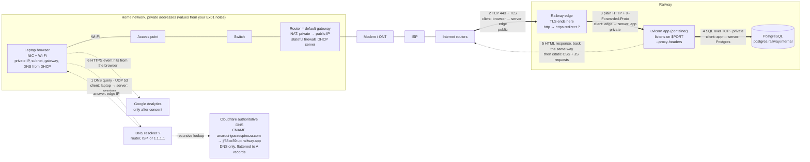
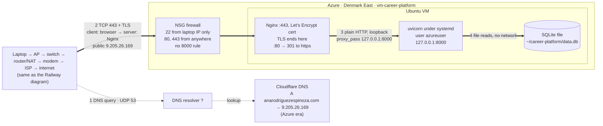

# Request path: entering the domain in a browser

Assumptions: a new HTTPS connection over TCP, and a DNS lookup with no cached answer. Items marked **?** are not recorded in this repository and still need to be checked.

## Railway

## Azure

## What changes between the two hosts

| | Azure | Railway |
| --- | --- | --- |
| DNS record | A record → VM public IP | CNAME → Railway, flattened |
| Firewall you manage | NSG rules | None, Railway owns the entry point |
| TLS ends at | Nginx on your VM, certbot renews | Railway edge, Railway renews |
| App to database | Local file, no network | TCP over Railway's private network |
| Keeps the app running | systemd, which you configured | Railway restart policy (`railway.json`) |

## Still to check

- Which DNS resolver the laptop uses: `scutil --dns`
- Whether Railway's edge redirects http to https: `curl -I http://anarodriguezespinoza.com`
- Home network addresses from Exercise 01
- Whether the Postgres port is 5432: read it from `DATABASE_URL` without printing the password
