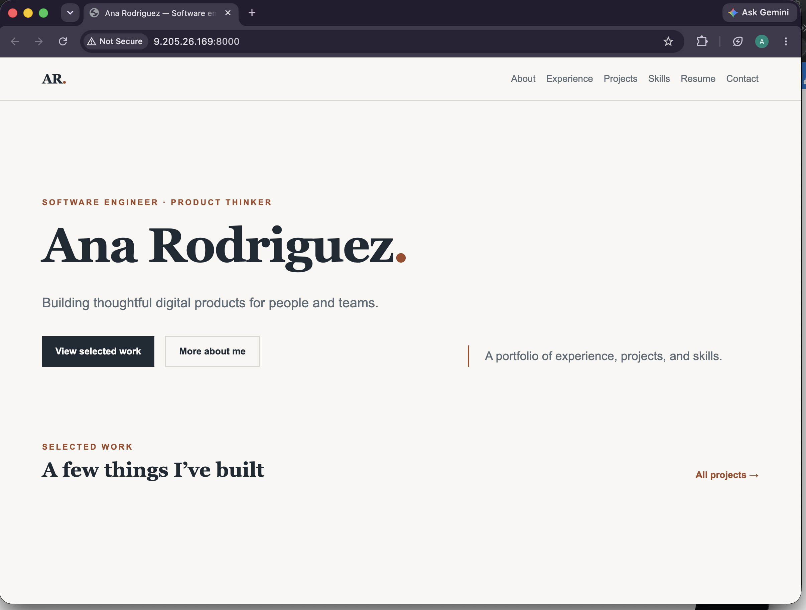

# Exercise 03 — Evidence

## 1. VM details

| Field | Value |
|---|---|
| Name | `vm-career-platform` |
| Resource group | `rg-career-platform` |
| Region | `denmarkeast` |
| Size | `Standard_B2ats_v2` |
| Public IP | `9.205.26.169` |
| Private IP | `172.16.0.4` (`eth0`, subnet `172.16.0.0/24`) |
| OS user | `azureuser`, SSH key only (`~/.ssh/isba4775_azure` on my laptop) |

Checked 2026-10-21 with `az vm show -d -g rg-career-platform -n vm-career-platform --query "{power:powerState,publicIp:publicIps,privateIp:privateIps}"` and `ip -4 addr show eth0` on the VM.

### Network rules and SSH access

The NSG `vm-career-platform-nsg` (from `az network nsg rule list`, 2026-10-21):

| Rule | Priority | Port | Source | Action | Why |
|---|---|---|---|---|---|
| `Allow-SSH-Laptop` | 300 | 22/TCP | my laptop's public IP only (`/32`) | Allow | Admin access. Anyone else trying SSH is dropped |
| `Allow-HTTP-80` | 310 | 80/TCP | any | Allow | Nginx redirects HTTP to HTTPS |
| `Allow-HTTPS-443` | 320 | 443/TCP | any | Allow | Nginx serves the site over TLS |
| (Azure default) | 65500 | any | any | Deny | Everything else, including 8000, is dropped silently |

The app itself listens on `127.0.0.1:8000`, so even a mistaken 8000 rule wouldn't expose it. The private IP `172.16.0.4` is only reachable inside the Azure virtual network. Traffic from the internet reaches the VM through the public IP, and Azure translates it to the private address.

On 2026-10-21 SSH timed out again because my laptop's public IP had changed from `157.242.208.225` to `157.242.208.31`. I updated `Allow-SSH-Laptop` to the new `/32`. This is the coffee-shop situation from section 4.

## 2. Screenshot

## 3. What went wrong

I ran into some small problems while setting up the server. At first, I couldn't reach port 8000 from my computer. My `curl` request did not fully go through and timed out after 5 seconds with no error. When I checked the azure inbound rules with `az network nsg rule list`, I found it only had one rule, which allowed the SSH from my laptop. It seems like azure quietly drops traffic that doesn't match a rule instead of rejecting it, which is why my request was not fully right. 

I also found that my migration plan had information that wasn’t true to what my branch had. But this was already listed as a possible issue regarding the uv.lock data, so I went and followed those steps before implementing the plan. Additionally, the verify section said an external `curl` to port 8000 had worked and listed specific database row counts. I re-ran the inbound port rule and the external `curl` test myself, and I confirmed twice that no port 8000 rule ever existed and that the app was only working locally, so that section was corrected before committing.

### The same failure, step by step

| Step | What I did and saw |
|---|---|
| Symptom | `curl http://9.205.26.169:8000/api/health` from my laptop hung and timed out after 5 seconds with no error message. |
| Check 1: is the app running? | From inside the VM the app answered, so the app and database were fine and the problem was between my laptop and the VM. |
| Check 2: does the network allow it? | `az network nsg rule list` showed one rule only: SSH from my laptop. Nothing allowed 8000. |
| Diagnosis | The NSG's default deny rule was dropping the packets. Azure drops instead of rejecting, so the client waits for a timeout instead of getting "connection refused". |
| Repair | For the exercise, I added an inbound rule for 8000. Later (see the [operate-the-vm plan](../superpowers/plans/2026-10-01-operate-the-vm.md)) I replaced that approach: the app moved to `127.0.0.1:8000` behind Nginx, the NSG opened only 80 and 443, and 8000 was closed again. |
| Re-check | With the rule in place, the site loaded from my laptop on port 8000 (screenshot in section 2). After the Nginx change, `curl http://9.205.26.169/api/health` returned `{"status":"ok","database":"up","publicSource":"database"}`, and `curl --max-time 5 http://9.205.26.169:8000/api/health` timed out again, as intended (2026-10-01). |

## 4. You're at a coffee shop and try to SSH into your VM to fix a typo. The command hangs.

The VM's inbound port only allows SSH from one specific IP address, which is the one I set up from home. At the coffee shop I have a different public IP, so the port drops my connection. I don't get an error, it just waits until it times out, which is the same thing that happened earlier with `curl` to port 8000 before I added that inbound port rule.

To fix it, I would log into the portal and change the rule to use the coffee shop's current public IP. The only cost will be the time it would take me to make that change, since adding an inbound rule does not cost any money.