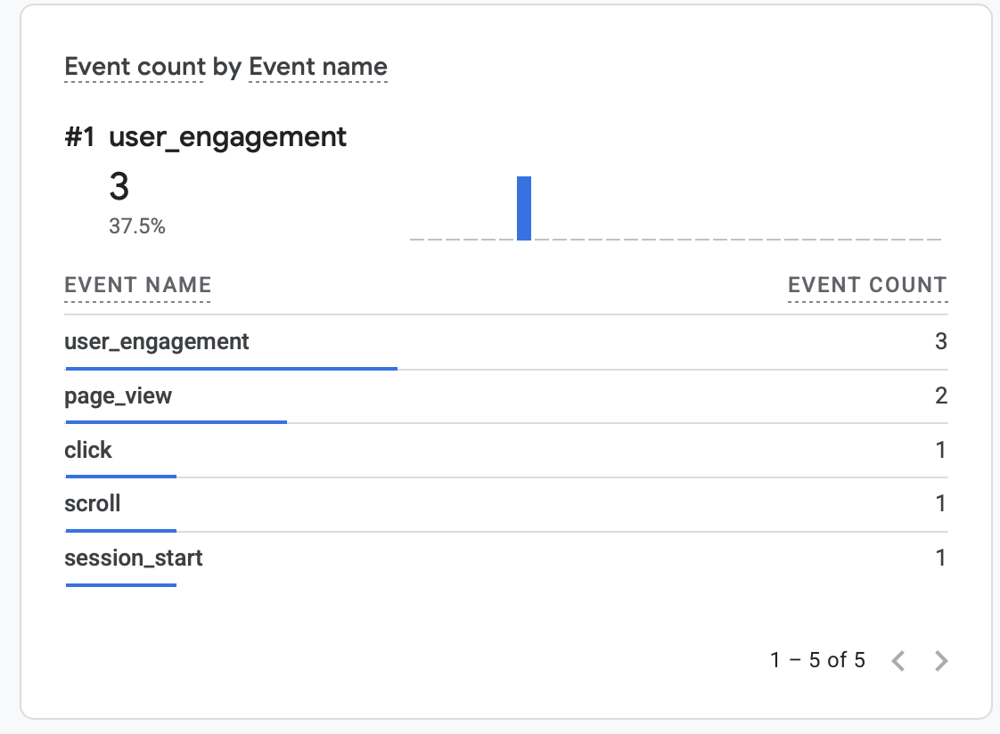
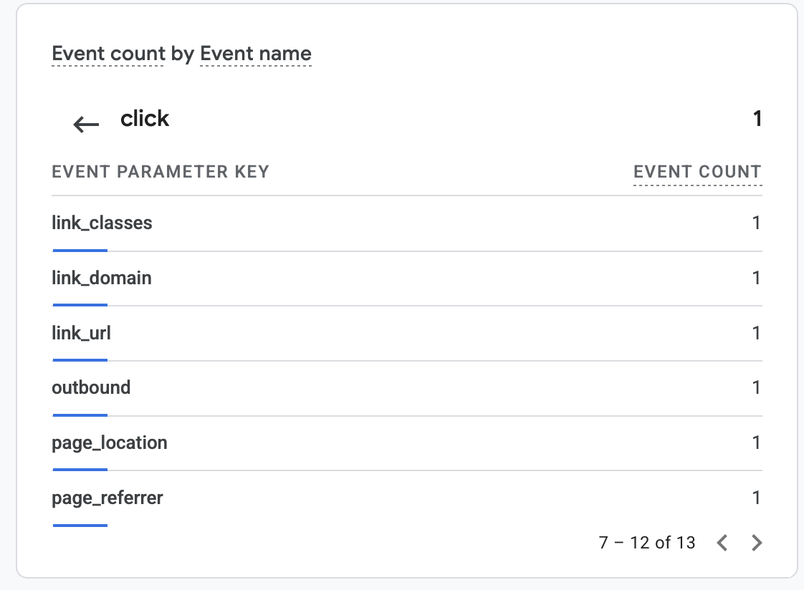

# Exercise 06 — Evidence

## 1. Email tests

Mailbox: Zoho Mail on `anarodriguezespinoza.com`. Outside mailbox: anarodriguez.e75@gmail.com. Times are Pacific and come from the Zoho MCP server (`ZohoMail_listEmails` / `ZohoMail_sendEmail`).

| Test | Subject | Direction | Time (PDT) | Result |
|---|---|---|---|---|
| Received | Test 01: Inbound | Gmail → Zoho | 2026-10-13 14:54 | Pass: arrived in the Zoho Inbox |
| Replied | Re: Test 01: Inbound | Zoho → Gmail | 2026-10-19 19:48 | Pass: Zoho accepted the send; it arrived in the Gmail inbox |
| Sent a new message | Test 02: outbound | Zoho → Gmail | 2026-10-13 14:56 | Pass: Zoho sent it; it arrived in the mailbox |

**Before-MX message:** "Test 00: before setup" was sent from Gmail to `ana@anarodriguezespinoza.com` before any MX record existed (the MX records were created 2026-10-13 14:36 PDT, see [dns-records-final.md](dns-records-final.md)). With no MX, a sending server falls back to the domain's A record, which pointed at Railway, and nothing there accepts mail on port 25. Gmail treated that as a temporary failure, kept the message in its queue, and retried. A retry after the MX records appeared reached Zoho: the message is in the Zoho inbox with a received time of **2026-10-13 15:16:30 PDT**, about 40 minutes after the MX records went in. It wasn't lost, only delayed. *(The exact time I sent it is in the Gmail Sent folder; the received time comes from `ZohoMail_SearchEmails`.)*

**The reply shows the custom address as the sender:** in the Zoho Sent folder, "Re: Test 01: Inbound" (2026-10-19 19:48:49 PDT) has `fromAddress: ana@anarodriguezespinoza.com`, and Gmail's "Show original" for it shows DKIM passing for `anarodriguezespinoza.com` (section 2). Messages sent from the Zoho web client (Tests 02 and 03) carry the sending display name `arodr170`. The address is correct, but the name should be changed to "Ana Rodriguez Espinoza" under Zoho Mail → Settings → Mail → Send Mail As.

**Personal address:** I decided to leave my personal Gmail address visible in this file. It's the outside mailbox for the tests, and showing it makes the direction of each test clear. I'm comfortable with it being in a class repository.

## 2. SPF, DKIM, and DMARC results

From Gmail's **Show original** for the outgoing reply (`Re: Test 01: Inbound`):

```text
SPF:	PASS with IP 165.173.180.52
DKIM:	'PASS' with domain anarodriguezespinoza.com
DMARC:	'PASS'
```

The DNS records: SPF `v=spf1 include:zohomail.com ~all`, DKIM selector `zmail`, and DMARC `v=DMARC1; p=none`. Full header analysis: [zoho-header-check.md](zoho-header-check.md).

### What each record does

- **MX (mail exchanger)** answers "where do I deliver mail for this domain?" `anarodriguezespinoza.com` has three: `mx.zoho.com` (10), `mx2.zoho.com` (20), `mx3.zoho.com` (50). Senders try the lowest number first and fall back to the others if it doesn't answer. MX only affects **incoming** mail.
- **SPF (Sender Policy Framework)** is a TXT record listing which servers may send mail **as** this domain. `include:zohomail.com` pulls in Zoho's sending IPs; `~all` says "anything else is suspicious" (soft fail) instead of rejecting outright. A receiver checks the connecting IP against this list. SPF checks the envelope sender (`Return-Path`), not the `From:` a person sees.
- **DKIM (DomainKeys Identified Mail)**: Zoho signs each outgoing message with a private key, and adds a `DKIM-Signature` header naming the domain (`d=anarodriguezespinoza.com`) and the selector (`s=zmail`). The receiver fetches the public key from `zmail._domainkey.anarodriguezespinoza.com` and verifies the signature, which proves the signed headers and body weren't changed and that the domain owner authorized the sender.
- **DMARC** ties the two together with the visible `From:` address. It passes when SPF or DKIM passes **and** its domain aligns with the `From:` domain. The policy tells receivers what to do on failure: `p=none` means deliver anyway and just report. `rua=mailto:ana@anarodriguezespinoza.com` is where aggregate reports go; Google's reports have been arriving in the Zoho inbox since 2026-10-15. Once the reports stay clean, the next step would be `p=quarantine`.

## 3. Google Analytics

- Live site: https://anarodriguezespinoza.com
- Privacy page: https://anarodriguezespinoza.com/privacy





### What I did, what GA recorded, and why it's useful

| | |
|---|---|
| Date | **TODO:** the date I ran the test. The screenshots were committed 2026-10-19 22:08 PDT, so it was that day or earlier |
| Action | On the live site I accepted the analytics banner, then clicked an outbound link. **TODO:** name the link, e.g. LinkedIn on `/resume` |
| Event observed | GA4 Realtime → "Event count by Event name" showed `page_view` and one `click`. The `click` event carried `link_url`, `link_domain`, `link_classes`, `outbound`, `page_location`, and `page_referrer` |
| Why it's useful | `click` with `outbound = true` is GA's enhanced-measurement outbound-link event. It shows which external profile (LinkedIn, GitHub) visitors actually leave to, and from which page (`page_location`). That tells me whether people who read the portfolio go on to my professional profiles, which a page-view count alone can't show |

### How a visit reaches Google Analytics

1. The browser loads a public page from `anarodriguezespinoza.com`. The HTML includes `/static/js/analytics-consent.js` with the measurement ID `G-JH0KBKW3K9`, and the consent banner. **No Google script is loaded yet**, and no request goes to Google.
2. **Consent gate.** The script reads the first-party `analytics_consent` cookie. With no choice saved, it shows the banner. If the browser sends Global Privacy Control, that counts as a decline. On **Decline**, the script stores `analytics_consent=denied`, deletes any `_ga` cookies, and never contacts Google.
3. On **Accept**, it stores `analytics_consent=granted` (180 days, `SameSite=Lax`, `Secure` on HTTPS). It sets Google Consent Mode defaults (`analytics_storage` granted; `ad_storage`, `ad_user_data`, `ad_personalization` denied; Google signals off), then injects `https://www.googletagmanager.com/gtag/js?id=G-JH0KBKW3K9`.
4. `gtag.js` sets the `_ga` and `_ga_JH0KBKW3K9` cookies and sends events **directly from the browser** over HTTPS (port 443) to Google's collection endpoint (`/g/collect` on a Google Analytics host): `page_view` on load, and enhanced-measurement events such as `click` for outbound links.
5. GA4 processes the hits; Realtime shows them within seconds, standard reports within about a day.

The FastAPI app and Railway never see or forward analytics data. The path is browser → Google only, and only after consent. The [privacy page](https://anarodriguezespinoza.com/privacy) lists the cookies.
