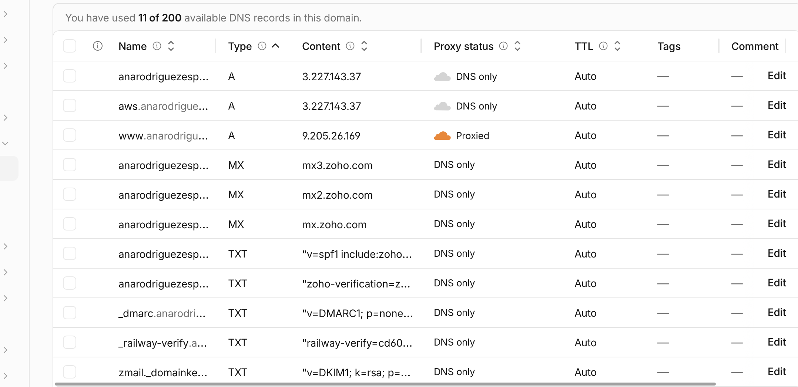
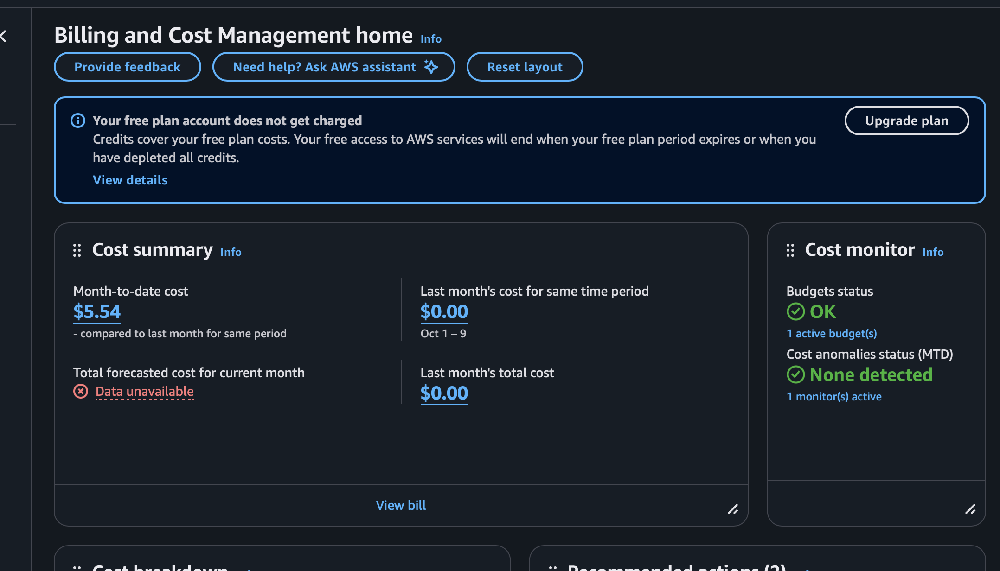

# Exercise 07: Migrate the site from Railway to AWS

The architecture diagram is in the README: [How the site runs](../../README.md#how-the-site-runs). The full step log and every deviation are in [migration-notes.md](../../migration-notes.md).

## 1. Architecture decision

I chose an EC2 instance with a Single-AZ RDS PostgreSQL database over EC2 with PostgreSQL on the same instance (and over Lambda + API Gateway + RDS) because I wanted to learn AWS without running the database myself, and I accepted paying for a second service, about $28 a month, and securing the network path between the two.

## 2. Backup record

| Item | Record |
| --- | --- |
| First backup and restore test | **2026-10-29.** `pg_dump -Fc` of Railway (PostgreSQL 18.6), restored into a new local PostgreSQL 18 database without touching Railway. `compare_databases` matched every row (23 of 23 across 7 tables), and the app ran on the restored copy (`/api/health` up, pages 200) |
| Restore into RDS | **2026-11-09** rehearsal and **2026-11-10** final restore, into the empty RDS database before any migration. Each took **2 s**, and each matched **26 of 26** rows against Railway (exit 0) |
| Backups now | RDS automated backups: a daily snapshot plus point-in-time restore, **kept 1 day**. The AWS Free plan refused 7 days with `FreeTierRestrictionError`. Plus manual `pg_dump` exports kept on my laptop, outside AWS and Git |
| Acceptable data loss (RPO) | **24 hours.** Only contact inquiries are written; losing a day means asking people to resend |
| Acceptable recovery time (RTO) | **4 hours** to restore and redeploy by hand |
| Not done yet | A second copy of the exports on separate storage, and a nightly export job |

## 3. Verification on `aws.anarodriguezespinoza.com`

Tested 2026-11-09 and 2026-11-10 (UTC), before the cutover, while Railway still served the real domain.

| Test | Evidence | Result |
| --- | --- | --- |
| DNS record | `nslookup`, `1.1.1.1`, and `8.8.8.8` all return `3.227.143.37`. Root and Zoho records unchanged | Pass |
| HTTPS certificate | Let's Encrypt (`YE1`) for `aws.anarodriguezespinoza.com`, valid to 2027-02-08. Verification passes (`ssl_verify_result` 0). `certbot renew --dry-run` succeeds | Pass |
| HTTP redirects to HTTPS | `http://aws…/about` returns `301` to `https://aws…/about` | Pass |
| Health and database | `/api/health` returns `{"status":"ok","database":"up","publicSource":"database"}` | Pass |
| Public pages | `/`, `/about`, `/projects`, `/skills`, `/experience`, `/resume`, `/contact`, `/privacy` all return `200`. `/skills` shows the restored rows | Pass |
| Resume PDF | `/api/resume` returns `200 application/pdf`, 3,559 bytes, the same as Railway | Pass |
| Contact form (write path) | `POST /contact` returns `303` to `https://aws…/contact?sent=1`. Inquiry count went from 14 to 15, saved as `FAILED` (no email configured, same as Railway). The test row was removed by the final restore | Pass |
| Restored data | `compare_databases` Railway → RDS: 26 matched, 0 changed, 0 missing | Pass |
| Restart and crash | `systemctl restart` comes back `active`. After `kill -9` on Uvicorn, systemd restarted it within 5 s and health was `ok` | Pass |
| Reboot | After a full instance reboot, `career-platform` and `nginx` came back `active` on their own and health was `ok` | Pass |
| App port private | Port 8000 is closed from the internet. Uvicorn listens on `127.0.0.1` only | Pass |
| Database private | RDS `PubliclyAccessible = false`. 5432 can't be reached from my laptop, only from the app's security group | Pass |
| SSH host key | All 3 fingerprints from `aws ec2 get-console-output` matched `ssh-keyscan` before connecting (on the replacement instance; the first instance skipped this and was terminated, see notes) | Pass |
| Padlock in my browser | Opening `https://aws.anarodriguezespinoza.com` myself | Not verified |

## 4. Cutover status

**Done on 2026-11-10 at about 06:59 UTC (Nov 9, 10:59 PM Pacific).**

1. **Freeze:** at 06:52:44 UTC, Railway's database was made read-only so no inquiry could be lost.
2. **Final copy:** the final dump was restored into RDS and matched 26 of 26 rows.
3. **DNS:** the root record changed from `CNAME → Railway` to `A → 3.227.143.37` (DNS only).
4. **Certificate:** certbot added `anarodriguezespinoza.com` to the certificate.

`https://anarodriguezespinoza.com` now serves from AWS: health `ok`, all pages `200`, `http://` and `www` redirect to the root, and the requests appear in the instance's Nginx log. Railway stays as a read-only standby for rollback.

## 5. Cost

**Estimate from section 6: $28.28 a month.** It comes from AWS's public us-east-1 price files on 2026-11-03: EC2 t3.micro $7.59, RDS db.t3.micro Single-AZ $13.14, RDS 20 GB gp3 $2.30, EBS 20 GB gp3 $1.60, and public IPv4 $3.65. Backups and data transfer are $0 at this size. The guide expected about $26.

What the account owner's billing page shows now:

